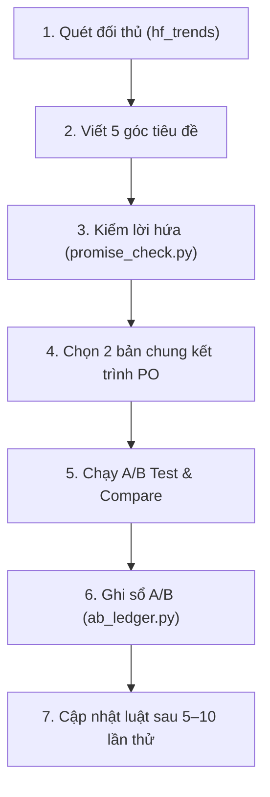

# Đóng gói Video Dài (Long Packaging): Tiêu đề & Thumbnail theo Số Liệu Thực Nghiệm

Quy chuẩn đóng gói video dài dựa trên nghiên cứu CTR ngày 11/11/2026 (`docs/research/thumb_ctr/report.md`) và quyết định PO (#282).
Mọi công cụ hỗ trợ nằm trong `tools/long_packaging/`.

---

## 1. Hệ thống luật có bằng chứng (FS)

| # | Luật | Bằng chứng thực nghiệm | Cỡ mẫu & Tương quan | Độ chắc |
|---|---|---|---|---|
| **L1** | **Long tra cứu theo tuổi:** Tên tuổi/can chi + năm là dòng to nhất, đứng đầu, $\le 4$ từ (vd: `TUỔI MÙI 2027`, `ĐINH MÙI 1967`). Dùng đúng cụm từ khoá người dùng gõ tìm. | Long một tuổi đạt CTR $\approx 8\%$ so với chủ đề chung $\approx 4,5\%$. CTR đi liền tỉ lệ view từ Search. | $n = 16$, Pearson $r = 0,87$, Spearman $0,81$ | **Vừa** |
| **L2** | **Chủ thể linh vật:** Một con vật linh vật cận mặt, mắt nhìn thẳng, cao $\ge 40\%$ khung hình ở nửa phải. Không dùng cảnh nhiều người nhỏ hay kiến trúc cho Long theo tuổi. | Cả 5 Long một tuổi có mặt con vật cận đều $\ge 7,7\%$ (Tuất, Sửu, Tý, Mùi 2027, Mão T10). Mão AIVANG 8,26% so với 3 con giáp cùng khuôn 4,71%. | $n = 5$ | **Thấp–vừa** |
| **L3** | **Long chủ đề chung (nhà, cưới, bàn thờ...):** Dòng phụ phải là câu hỏi tra cứu cá nhân ("năm sinh nào...?", "tuổi bạn...?"), kèm năm. | NAVY chung có câu hỏi năm sinh đạt 4,7–7,9%; chung không neo chỉ đạt 2,1–2,4%. | $n = 6$ | **Thấp** |
| **L4** | **Số lượng chữ:** Tổng chữ $\le 9$ từ, $\le 2$ cỡ chữ. Bỏ các dòng chữ li ti. | 8 thumbnail $\ge 7,7\%$ đều có 5–9 từ và $\le 2$ cỡ chữ. | $n = 8$ | **Thấp** |
| **L5** | **Không kỳ vọng đổi khuôn cứu chủ đề sống bằng Browse:** Tài liệu/nhân vật (Tả Ao, Huế, Tần) ở 1,4–2,3% dù có tên mỏ neo. Cần chọn chủ đề có lượng tìm kiếm trước khi làm thumbnail. | Cùng khuôn THUYMAC/DO25 mà CTR chênh 2–2,5 lần. | $n = 12$ | **Vừa** |
| **L6** | **Quy tắc đo lường:** Chỉ kết luận khi có $\ge 1.500$ impressions trong cùng cửa sổ tuổi video. Không so video Search với video Browse. Thay thumbnail giữa đời phải ghi mốc để tách dữ liệu. | Tuổi video làm lệch số (Io70: trọn đời 7,7% so với 11,6% ở 28d muộn). | Toàn kênh | **Cao** |

### Đặc thù kênh Phật giáo (BUD)
- 13 Long tháng 10–11 nằm gọn trong dải **2,0–4,1%**, không phân biệt nhiều theo kiểu thumbnail.
- BUD không có cơ chế "tra cứu theo tuổi". Tín hiệu tốt duy nhất là tên riêng nhân vật nổi tiếng (Đường Tăng 4,11%, Konagamana 13,5%).
- Không áp đặt luật L1–L4 của FS sang BUD. Với BUD, ưu tiên tên riêng quen thuộc và hình ảnh tượng/phù điêu trang nghiêm.

---

## 2. Nguyên tắc Tiêu đề & Thumbnail

1. **Tiêu đề phải là một câu hỏi có đáp án thật trong video:**
   - Ngắn hơn chưa chắc hút hơn. Tiêu đề hay khơi gợi tò mò nhưng nội dung phải trả lời trọn vẹn.
   - Ví dụ thắng: *"Thiền Hơi Thở Cho Người Mới: Càng Cố Tĩnh Tâm, Càng Nhiều Suy Nghĩ?"* (có nguyên chương "Khi tâm chạy đi" giải đáp).
2. **Khuôn tên mỏ neo:**
   - Dạng: `[MỎ NEO VIẾT HOA] Ngoài Đời Thật: [Nhân vật / Vấn đề] — [Câu hỏi nghịch lý]?`
   - Ví dụ: `TRẠNG TRÌNH Ngoài Đời Thật: Ai Đã Viết Những Lời Sấm Mang Tên Ông?`
3. **Thumbnail:**
   - Ưu tiên **2–5 từ**, tối đa 8 từ khi cần nói rõ nghịch lý (PO 03/11).
   - Đọc hiểu trong 1–2 giây trên màn hình điện thoại ở kích thước thu nhỏ (168 px).
   - Nền AI không chữ (mặt cận, chừa khoảng trống) + chữ tự đặt bằng `thumb_cb.py`.
4. **Giới hạn an toàn & đạo đức kênh:**
   - **FS:** Tuyệt đối không hứa số tiền cụ thể, không "chắc chắn giàu", trúng số, khuyên vay vốn/đầu tư, bán bùa ngải.
   - **BUD:** Lời Đức Phật chỉ dùng khi đã đối chiếu nguyên văn kinh điển (`hf_sutta.py`). Không gán chi tiết ngoài kinh.

---

## 3. Quy trình 7 bước chuẩn



1. **Quét tiêu đề đối thủ:** Chạy `python hf_trends.py bud fs` xem các video nhiều view/ngày gần đây trong ngách.
2. **Viết 5 góc dạng "câu hỏi có đáp án":**
   - Góc 1: Tra cứu trực diện (Search).
   - Góc 2: Nghịch lý / hiểu lầm phổ biến.
   - Góc 3: Mỏ neo nhân vật ngoài đời thật.
   - Góc 4: Hướng dẫn thực hành / giải pháp.
   - Góc 5: Trải nghiệm cá nhân hoá ("Tuổi của bạn...").
3. **Kiểm lời hứa trong kịch bản:**
   - Chạy:
     ```bash
     .venv/bin/python tools/long_packaging/promise_check.py <plan.json> --only <id> --question "<câu hỏi>"
     ```
   - **Quy tắc:** Phần trả lời trong `script[]` phải đạt $\ge 3$ câu. Nếu $< 3$ câu, công cụ báo `CẢNH BÁO: phần trả lời quá mỏng` $\rightarrow$ Phải viết bổ sung kịch bản hoặc đổi câu hỏi.
4. **Chọn 2 bản vào chung kết để PO duyệt:** Lấy 2 phương án tốt nhất kèm thiết kế thumbnail tương ứng.
5. **Chạy A/B bằng Test & Compare trên YouTube Studio:** Đưa 2–3 phương án vào tính năng thử nghiệm chính thức của YouTube.
6. **Ghi sổ A/B:**
   - Mở thử nghiệm:
     ```bash
     .venv/bin/python tools/long_packaging/ab_ledger.py add --video <id> --key <key> --var-a "<mô tả A>" --var-b "<mô tả B>" --rule L1
     ```
   - Khi có kết quả:
     ```bash
     .venv/bin/python tools/long_packaging/ab_ledger.py close --video <id> --winner B --imp-a 5000 --imp-b 5200 --ctr-a 7.2 --ctr-b 8.4 --notes "B mặt cận thắng"
     ```
7. **Cập nhật luật sau mỗi 5–10 lần thử:** Định kỳ đối soát lại các luật L1–L6 dựa trên dữ liệu tích luỹ trong sổ `packaging_ab.jsonl`.

---

## 4. Bộ công cụ trong repo

- **`tools/long_packaging/promise_check.py`**: Quét kịch bản, xác định chương và số câu trả lời cho tiêu đề/thumbnail; cảnh báo khi $< 3$ câu.
- **`tools/long_packaging/ab_ledger.py`**: Quản lý sổ ghi chép thử nghiệm A/B (`output/cl_staging/long/packaging_ab.jsonl`).
- **`tools/long_packaging/apply_meta.py`**: Áp tiêu đề mới, thay 2 câu đầu mô tả và gộp tag cho video đã hẹn giờ. Mặc định dry-run, ghi backup trước khi áp.
- **`tools/long_packaging/reschedule.py`**: Dời lịch phát sóng theo kế hoạch định trước, giải phóng chuỗi ô bị chiếm và phá vòng lặp. Mặc định dry-run, ghi sổ khôi phục.
